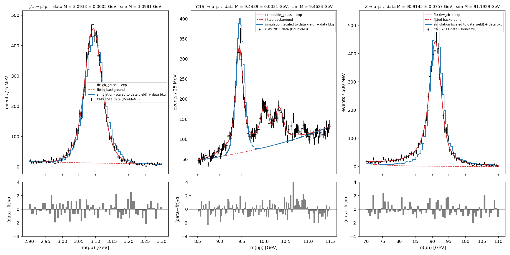

# Particle Physics Lab

Simulates J/ψ, Υ(1S) and Z decays to μ⁺μ⁻ and passes them through a CMS-inspired tracker model. It then reconstructs the muons, fits the mass peaks with extended likelihood fits, and compares the results with CMS 2011 open data (CERN Open Data record 545) using the same selection.

The model is educational: every step has a stated equation, assumption and test. It is not a CMS simulation.

## Quick start

```bash
pip install -r requirements.txt
```

```bash
python -c "from particlelab.data import cms; cms.fetch()"
```

```bash
python gui.py
```

```bash
python run_analysis.py
```

```bash
python -m pytest
```

## Contents

| Path | What |
|---|---|
| `particlelab/domain` | PDG 2026 particle database (`particles_pdg.json`) and the conservation-law engine |
| `particlelab/physics` | production line shapes and spectra, two-body decay (Collins–Soper / isotropic), Lorentz boosts, invariant mass |
| `particlelab/detector` | CMS-inspired and uniform-reference geometries, hit simulation (multiple scattering, smearing, efficiency), weighted circle and line fits |
| `particlelab/analysis` | memory-bounded simulation pipeline, likelihood fitter and line shapes, toy MC, resolution studies, data–simulation comparison |
| `particlelab/data` | CMS CSV ingestion: checksum, schema and row validation, selection with cut flow |
| `particlelab/visualization` | renderer-independent event-display data (detector shapes, true and reconstructed helices, hits, vertex, momentum arrows) |
| `particlelab/app` | desktop GUI (PySide6, pyqtgraph) with a PyVista 3D event display |
| `run_analysis.py`, `configs/` | reproducible end-to-end analysis |
| `references/` | digitised CMS reference curves (tracker material budget, single-muon resolution) with their provenance |
| `calibration/` | fit of the detector material to the CMS material reference (never to the dimuon data) |
| `audit/` | scripts and evidence of the independent audit (`docs/validation/FINAL_INDEPENDENT_AUDIT.md`) |
| `benchmarks/bench.py` | throughput and memory benchmark |
| `tests/` | unit, property-based, integration, physics-validation and regression tests |

## Results at a glance

| | data (CMS 2011) | simulation | sim/data peak width |
|---|---|---|---|
| J/ψ | 3.0933 ± 0.0005 ± 0.0003 GeV | 3.0981 GeV | 1.07 |
| Υ(1S) | 9.4439 ± 0.0031 ± 0.0011 GeV | 9.4624 GeV | 0.96 |
| Z | 90.915 ± 0.076 ± 0.030 GeV | 91.193 GeV | 0.94 |

Data masses are given with their statistical and systematic uncertainties. The detector material is calibrated to the published CMS material budget, never to these data. The data peaks sit 0.1–0.3 % below the PDG values, more so in the forward region, which points to the uncalibrated momentum scale of the open-data files. Details: `docs/validation/CMS_DATA_COMPARISON.md`.



Documentation is in `docs/`, covering engineering, physics, validation, research and the user guide. The results of the last full run are in `outputs/report.md`.

## Licence

MIT, see `LICENSE`. The CMS data file is CC0 (CERN Open Data record 545) and is downloaded on demand, not stored in this repository.
